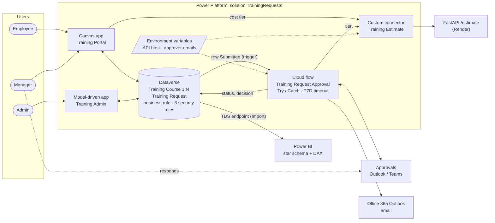

# Training Request Portal


**Power Apps · Power Automate · Dataverse · Power BI · FastAPI · Power Platform ALM**

Employees often request training through email threads and spreadsheets, so requests get lost,
approvals stall, and nobody can say what's been spent. This project replaces that process with
a Power Platform solution:

- Employees browse a course catalog and submit requests in a **canvas app**.
- The request's approver gets an **approval in Outlook/Teams** through Power Automate. Expensive
  courses, flagged by a **FastAPI service behind a custom connector**, go to a second approver.
- Admins manage the catalog in a **model-driven app**.
- A **Power BI** star-schema dashboard tracks volume, approval rate, spend, and time to decision.

Row-level access is enforced by **Dataverse security roles**, not by app logic. Everything ships as
one solution, versioned in Git as unpacked source.


## Architecture



## Data model

Full spec in [`dataverse/schema.md`](dataverse/schema.md).

| Table | Key columns |
|---|---|
| **Training Course** `jc_trainingcourse` | Name · Provider · Category (Technical / Leadership / Compliance / Professional Development) · Cost · Hours · Active |
| **Training Request** `jc_trainingrequest` | Title · Course (lookup, N:1) · Justification · Request Status (Draft / Submitted / Approved / Rejected / Completed / Error) · Approver (lookup → User) · Submitted On · Decision Date · Decision Comments · Course Cost |

- **Business rule (Entity scope):** Justification is required when Course Cost > $1,000.
  Because the rule runs server-side, it blocks saves from the app, flows, the API, and imports, not
  only from forms.
- **Course Cost** is copied onto the request at submit time. Business rules can't read columns
  through a lookup, and copying the cost also means reporting uses the price that was actually
  requested.
- The Course relationship uses **Restrict delete**, so a course with requests can't be deleted.
  It's deactivated instead.

## Security roles

Details in [`dataverse/security-roles.md`](dataverse/security-roles.md).

| Role | Training Request | Training Course |
|---|---|---|
| Training Employee | Create / Read / Write: **User** | Read: **Organization** |
| Training Manager | Read / Write: **Business Unit** | Read: **Organization** |
| Training Admin | All: **Organization** | All: **Organization** |

Because Dataverse enforces row visibility, an employee can't see other people's requests
through any client: the app, the Web API, Excel, or Power BI. The app's filters are for
convenience, not security.

## Apps

**Canvas app: Training Portal** ([spec](powerapps/canvas-app.md))

| Screen | What it does |
|---|---|
| My Requests | Delegable gallery of the user's own requests, color-coded by status |
| New Request | Edit form with client-side validation, *Save as draft*, and a live cost-per-hour / tier estimate from the custom connector, wrapped in `IfError` so an API outage doesn't block submission |
| Course Catalog | Active courses with delegable `StartsWith` search + category filter; "Request" preselects the course |
| Manager Review | Visible only to managers (role lookup in `App.Formulas`); approve/reject with `Patch`, and comments are mandatory for rejections |

**Model-driven app: Training Admin** ([spec](powerapps/model-driven-app.md)): catalog
management with *Active Courses* and *Pending Requests* views, and a course form with a
related-requests subgrid.

## Approval flow & error handling

Spec in [`flow/approval-flow.md`](flow/approval-flow.md).

1. **Trigger:** Dataverse row *added or modified*, with `jc_requeststatus eq Submitted` and
   **select column** `jc_requeststatus`. The flow only runs when the status actually changes. Its
   own Approved/Rejected update no longer matches the filter, so the flow can't loop.
2. **`Try` scope:** get the course, approver, and requester → call the **custom connector** for a
   cost tier → **manager approval** (timeout `P7D`) → if approved and tier is `high`, run a **second
   approval** → **re-read the row** and only write the decision if it is still `Submitted`. This
   guard stops a stale email response from overwriting a decision made in the canvas app. Then
   update the row and email the requester.
3. **`Catch` scope:** *run after* Try **has failed** or **has timed out**. It filters
   `result('Try')` for the failed or timed-out action, sets the request to **Error** with the reason,
   emails the admin the error plus a **direct link to the run**, and then **Terminates as
   Failed**. Without that last step, the run would show as succeeded and never reach monitoring.

The retry policy on the connector action (exponential, 3×) absorbs cold starts on the free API host.

| Test | Result |
|---|---|
| Approve / reject from Teams | Status + decision + requester email ⬜ |
| $2,495 course | Second approval required ⬜ |
| Decided in app first, email answered later | Flow skips its update ⬜ |
| Forced failure (bad row ID) | Status = Error, admin email with run link, run marked Failed ⬜ |
| Approval timeout (shortened to 2 min) | Catch path via `TimedOut` ⬜ |

> Tick each box (⬜ → ✅) after running it, and add a screenshot of the failed run:
> `docs/screenshots/flow-catch.png`.

## REST API + custom connector

[`api/`](api) is a FastAPI service with pytest coverage and CI. It is deployed to Render from
[`render.yaml`](render.yaml).

```
GET /estimate?cost=2495&hours=24   (X-API-Key header)
→ {"cost":2495.0,"hours":24,"cost_per_hour":103.96,"tier":"high","premium_rate":true,"requires_second_approval":true}
```

FastAPI emits OpenAPI 3.0, but custom connectors expect Swagger 2.0, so
[`connector/apiDefinition.swagger.json`](connector/apiDefinition.swagger.json) is hand-written to
match. The connector reads its host from the **`jc_EstimateApiHost` environment variable**, so each
environment (dev/test/prod) can point at a different API without editing the connector.

## Power BI

Spec, queries, and measures are in [`powerbi/`](powerbi).

- **Star schema:** fact *Training Request*, dimensions *Training Course* and *Date*. The Date table
  has an active relationship on Submitted Date and an **inactive** one on Decision Day, which
  `USERELATIONSHIP` uses.
- **Measures:** Total / Approved / Pending Requests, **Approval Rate** (over *decided* requests, so
  pending ones don't drag it down), **Approved Spend**, **Avg Days to Decision** (hour-precise),
  month-over-month approval-rate change, and oldest pending request.
- **Performance:** columns pruned in Power Query, Import mode, measures instead of calculated
  columns, and `SUM` over a fact column instead of `SUMX(RELATED())`.

| Visual (Performance Analyzer) | DAX query (ms) | Total (ms) |
|---|---|---|
| Approval Rate card | _tbd_ | _tbd_ |
| Requests by month | _tbd_ | _tbd_ |
| Spend by category | _tbd_ | _tbd_ |
| Pending table | _tbd_ | _tbd_ |


## ALM & source control

- All components (tables, business rule, roles, both apps, flow, connector, environment variables)
  live in the **TrainingRequests** solution under the `jc` publisher.
- [`scripts/export-solution.sh`](scripts/export-solution.sh) runs `pac solution export` and
  `pac solution unpack --processCanvasApps` into [`src/`](src). The canvas app becomes
  readable `.pa.yaml`, and flows and tables become JSON and XML that can be diffed in a PR.
- [`scripts/pack-solution.sh`](scripts/pack-solution.sh) does the reverse, for importing into
  another environment.
- **CI:** [`api-ci.yml`](.github/workflows/api-ci.yml) runs the API tests on every push.
  [`export-solution.yml`](.github/workflows/export-solution.yml) uses Microsoft's Power Platform
  Actions to export and unpack the solution and open a PR with the diff.

### CI/CD service principal (for the export workflow)

1. Entra admin center → **App registrations → New**, named `training-portal-cicd`. Create a
   **client secret**.
2. Power Platform admin center → your environment → **Settings → Users + permissions →
   Application users → + New app user**. Pick the app, choose your business unit, and assign the
   **System Customizer** role.
3. GitHub → **Settings → Secrets → Actions**: add `PP_ENVIRONMENT_URL`, `PP_TENANT_ID`, `PP_APP_ID`,
   and `PP_CLIENT_SECRET`.

## Repository layout

```
api/                 FastAPI service + tests
connector/           Swagger 2.0 definition + properties for the custom connector
dataverse/           Schema, security roles, seed CSVs, Web API seed script
docs/                Build guide, screenshots
flow/                Approval flow spec (actions, expressions, test plan)
powerapps/           Canvas app (Power Fx) and model-driven app specs
powerbi/             Power Query, Date table, DAX measures, model guide, .pbix
scripts/             pac export / pack
src/                 Unpacked solution (generated by scripts/export-solution.sh)
.github/workflows/   API CI, solution export
```

## Reproduce it

Follow [`docs/BUILD_GUIDE.md`](docs/BUILD_GUIDE.md). To import the finished solution into your own
environment instead:

```bash
./scripts/pack-solution.sh
pac solution import --path out/TrainingRequests_packed.zip
```

After importing, set the environment variable values and create the connections the import asks for.
