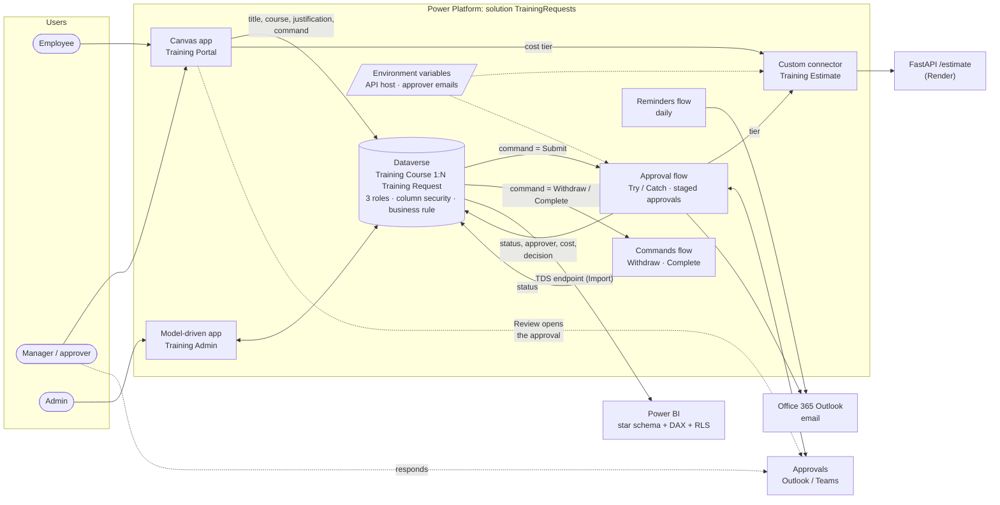
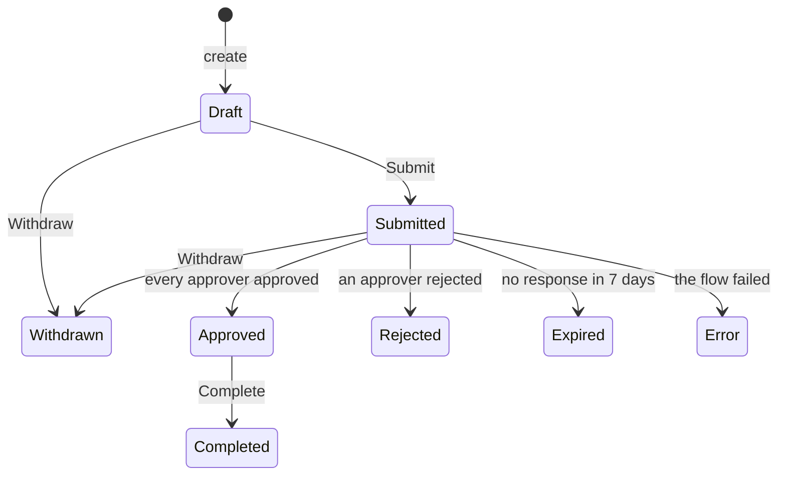

# Training Request Portal


**Power Apps · Power Automate · Dataverse · Power BI · FastAPI · Power Platform ALM**

Employees often request training through email threads and spreadsheets, so requests get lost,
approvals stall, and nobody can say what's been spent. This project replaces that process with
a Power Platform solution:

- Employees browse a course catalog and submit requests in a **canvas app**.
- The requester's manager gets an **approval in Outlook/Teams** through Power Automate. Expensive
  courses, flagged by a **FastAPI service behind a custom connector**, go to a second approver.
- Admins manage the catalog and handle exceptions in a **model-driven app**.
- A **Power BI** star-schema dashboard tracks volume, approval rate, spend, and time to decision.

Who can see a request is enforced by **Dataverse security roles**, and who can decide one by
**column-level security**, not by app logic. Everything ships as one solution, versioned in Git as
unpacked source.

<!-- Uncomment once the file exists (docs/BUILD_GUIDE.md step 11):

-->

## Project status

This repository is the complete specification plus the parts that are ordinary code. The Power
Platform components are built in the maker portal by following
[`docs/BUILD_GUIDE.md`](docs/BUILD_GUIDE.md), then exported into `src/`.

| Part | State |
|---|---|
| Estimate API, connector definition, contract tests | ✅ Code, tested in CI |
| Seed data and seed script | ✅ Code, tested in CI |
| Dataverse model, security, apps, flows, Power BI model | 📝 Specified in this repo; ⬜ not yet built in an environment |
| `src/` (unpacked solution), `.pbix`, screenshots | ⬜ Produced by the build |

## Architecture



## How a request moves

The app never writes a request's status. It writes a **command**, and a flow applies the command if
the current status allows it.



This is the design decision the rest follows from. Because status, approver, cost, and decision are
written only by the flows:

- an employee cannot approve their own request, even with a direct Web API call,
- a high-cost request cannot skip its second approval,
- the cost that drives routing and reporting is the catalog's, not one the client sent,
- the requester is always told the outcome, because the same flow that records it sends the email.

## Data model

Full spec in [`dataverse/schema.md`](dataverse/schema.md).

| Table | Key columns |
|---|---|
| **Training Course** `jc_trainingcourse` | Name · Provider · Category (Technical / Leadership / Compliance / Professional Development) · Cost · Hours · Active |
| **Training Request** `jc_trainingrequest` | *Requester writes:* Title · Course (lookup, N:1, set once) · Justification · Requested Action (Submit / Withdraw / Complete)<br/>*Flows write:* Request Status (Draft / Submitted / Approved / Rejected / Completed / Withdrawn / Expired / Error) · Approver · Pending With · Approval Link · Course Cost · Submitted On · Decision Date · Decision Comments · Completed On |

- **The requester is the row's owner.** The security roles, the app, the flows, and the dashboard all
  use that one definition.
- **Business rule (Entity scope):** Justification is required when Course Cost > $1,000.
  Because the rule runs server-side, it blocks saves from flows, the API, and imports, not only
  from forms.
- **Course Cost** is copied from the catalog by the approval flow at submit time. Business rules
  can't read columns through a lookup, and copying the cost also means reporting uses the price
  that was actually requested.
- The Course relationship uses **Restrict delete**, so a course with requests can't be deleted.
  It's deactivated instead.

## Security

Details in [`dataverse/security-roles.md`](dataverse/security-roles.md).

**Rows: security roles**

| Role | Training Request | Training Course |
|---|---|---|
| Training Employee | Create / Read / Write: **User** | Read: **Organization** |
| Training Manager | Read: **Business Unit** | Read: **Organization** |
| Training Admin | All: **Organization** | All: **Organization** |

**Columns: column security profiles**

| Profile | Course | Status, approver, cost, dates, decision | Held by |
|---|---|---|---|
| Read Decision Fields | Set on create only | Read only | Every user |
| Write Decision Fields | Read / write | Read / write | The flows' service account, admins |

Because Dataverse enforces both, they hold for every client that signs in as the user: the app,
the Web API, and Excel. The app's filters are for convenience, not security.

Power BI is the exception, and is handled separately. An imported model is a copy made with the
refresh account's access, so the report defines its own **row-level security** on the manager
hierarchy ([`powerbi/model.md`](powerbi/model.md#5-row-level-security)).

## Apps

**Canvas app: Training Portal** ([spec](powerapps/canvas-app.md))

| Screen | What it does |
|---|---|
| My Requests | Delegable gallery of the user's own requests, color-coded by status, with the actions valid for each status: edit or discard a draft, withdraw, mark completed, request again |
| New Request / Edit Draft | One form for both. Client-side validation, *Save as draft*, and a live cost-per-hour / tier estimate from the custom connector, wrapped in `IfError` so an API outage doesn't block submission |
| Course Catalog | Active courses with delegable `StartsWith` search + category filter; "Request" preselects the course |
| Waiting on me | The approvals currently assigned to the signed-in user, oldest first. **Review and respond** opens the approval itself |

**Model-driven app: Training Admin** ([spec](powerapps/model-driven-app.md)): catalog
management with *Active Courses*, *Pending Requests*, and *Needs Attention* views, and a course form
with a related-requests subgrid. Admins settle exceptions here.

## Flows & error handling

Specs in [`flow/`](flow).

**Training Request Approval** ([spec](flow/approval-flow.md))

1. **Trigger:** Dataverse row *added or modified*, filtered to `jc_requestedaction eq Submit` with
   **select column** `jc_requestedaction`. The flow's first write clears the command, so it can't
   re-trigger itself. A Submit on anything but a Draft is cleared and ignored.
2. **`Try` scope:** mark Submitted → resolve the approver from the requester's **manager** → stamp
   approver and catalog cost → call the **custom connector** for a cost tier → run the approval
   **stages in order** (manager, then a second approver if the tier is `high`). Each stage creates
   an approval, publishes its link to the row, and waits up to `P7D`. A rejection ends the stages.
   A **timeout is a business outcome**, handled on its own branch: the request becomes *Expired*
   and the requester is told. Finally the flow **re-reads the row** and writes the decision only if
   it is still Submitted, so a withdrawal or an admin's decision made in the meantime stands.
3. **`Catch` scope:** *run after* Try **has failed** or **has timed out**. It filters
   `result('Try')` for the failed action, sets the request to **Error** with the reason (only if
   the request is still waiting on this run), emails the requester and the admin with a **direct
   link to the run**, and then **Terminates as Failed**. Without that last step, the run would show
   as succeeded and never reach monitoring.

The retry policy on the connector action (exponential, 3×) absorbs cold starts on the free API host.

**Training Request Commands** ([spec](flow/commands-flow.md)) applies Withdraw and Complete after
re-reading the row's current status. **Training Request Reminders** ([spec](flow/reminders-flow.md))
emails whoever a request has been waiting on for 3 days, with the approval link.

| Test | Result |
|---|---|
| Approve / reject from Teams or from the app's Review button | Status + decision + requester email ⬜ |
| $2,495 course | Second approval required; skipped if the manager rejects ⬜ |
| Withdrawn while pending, approval answered later | Flow skips its update ⬜ |
| No response (timeout shortened to 2 min) | Status = Expired, requester told, run Succeeded ⬜ |
| Expensive course, no justification, submitted through the Web API | Business rule blocks the cost stamp → Error ⬜ |
| Forced failure (bad API host) | Status = Error, admin email with run link, run marked Failed ⬜ |
| Requester sets own status to Approved through the Web API | 403 ⬜ |

> Tick each box (⬜ → ✅) after running it.

<!-- Uncomment once the file exists:

-->

## REST API + custom connector

[`api/`](api) is a FastAPI service with pytest coverage and CI. It is deployed to Render from
[`render.yaml`](render.yaml).

```
GET /estimate?cost=2495&hours=24   (X-API-Key header)
→ {"cost":2495.0,"hours":24,"cost_per_hour":103.96,"tier":"high","premium_rate":true,
   "requires_second_approval":true,"high_cost_threshold":1000.0}
```

- **Fails closed.** Without a configured `API_KEY` the service answers 503 instead of serving
  everyone. Keys are compared in constant time.
- **Bounded input.** `cost` and `hours` have upper limits, so `inf` or absurd values are a 422, not
  a crash or a nonsense approval email.
- **The threshold has one owner.** `HIGH_COST_THRESHOLD` decides the tier and is returned in the
  response, so the canvas app shows the same number the flow routes on.

FastAPI emits OpenAPI 3, but custom connectors expect Swagger 2.0, so
[`connector/apiDefinition.swagger.json`](connector/apiDefinition.swagger.json) is hand-written to
match. **Contract tests** compare the two on every push, so they can't drift silently. The connector
reads its host from the **`jc_EstimateApiHost` environment variable**, so each environment
(dev/test/prod) can point at a different API without editing the connector.

## Power BI

Spec, queries, and measures are in [`powerbi/`](powerbi).

- **Star schema:** fact *Training Request*, dimensions *Training Course*, *Requester*, and *Date*.
  The Date table follows the data's range and has an active relationship on Submitted Date and an
  **inactive** one on Decision Day, which `USERELATIONSHIP` uses.
- **Measures:** Total / Approved / Pending / Expired Requests, **Approval Rate** (over *decided*
  requests, so unanswered ones don't drag it down), **Completion Rate**, **Approved Spend**, **Avg
  Days to Decision** (hour-precise), month-over-month approval-rate change, and oldest pending request.
- **Row-level security:** one role built on the manager hierarchy (`PATH` / `PATHCONTAINS`) shows
  each viewer their own requests and their reports'; a second role shows everything.
- **Performance:** columns pruned in Power Query, Import mode, measures instead of calculated
  columns, and `SUM` over a fact column instead of `SUMX(RELATED())`.

| Visual (Performance Analyzer) | DAX query (ms) | Total (ms) |
|---|---|---|
| Approval Rate card | _tbd_ | _tbd_ |
| Requests by month | _tbd_ | _tbd_ |
| Spend by category | _tbd_ | _tbd_ |
| Pending table | _tbd_ | _tbd_ |

<!-- Uncomment once the file exists:

-->

## ALM & source control

- All components (tables, business rule, roles, column security profiles, both apps, three flows,
  connector, environment variables) live in the **TrainingRequests** solution under the `jc` publisher.
- [`scripts/export-solution.sh`](scripts/export-solution.sh) exports the unmanaged and managed
  packages and unpacks them together (`--packagetype Both --processCanvasApps`) into [`src/`](src).
  The canvas app becomes readable `.pa.yaml`, and flows and tables become JSON and XML that can be
  diffed in a PR.
- [`scripts/pack-solution.sh`](scripts/pack-solution.sh) builds a **managed** zip from that source
  for test and production (or unmanaged, for another dev environment).
- [`deploy/`](deploy) holds one **deployment settings file** per target: the environment variable
  values and connection IDs that differ between environments.
- **CI:**
  - [`api-ci.yml`](.github/workflows/api-ci.yml) and [`seed-ci.yml`](.github/workflows/seed-ci.yml)
    lint and test the Python on every push.
  - [`export-solution.yml`](.github/workflows/export-solution.yml) uses Microsoft's Power Platform
    Actions to export and unpack the solution and open a PR with the diff.
  - [`deploy-solution.yml`](.github/workflows/deploy-solution.yml) packs the managed solution from
    `src/`, runs the **solution checker**, and imports it into `test` or `prod` with that target's
    settings file. Targets are GitHub Environments, so `prod` can require a reviewer.

### CI/CD service principal

1. Entra admin center → **App registrations → New**, named `training-portal-cicd`. Create a
   **client secret**.
2. Power Platform admin center → each environment → **Settings → Users + permissions →
   Application users → + New app user**. Pick the app and choose your business unit. Assign
   **System Customizer** in dev (export only) and **System Administrator** in test and prod
   (importing security roles and flows needs it).
3. GitHub → **Settings → Secrets → Actions**: add `PP_ENVIRONMENT_URL`, `PP_TENANT_ID`, `PP_APP_ID`,
   and `PP_CLIENT_SECRET` as repo secrets for dev, and again as **environment** secrets on the
   `test` and `prod` GitHub Environments.

## Known limitations

- **Approvals can't be cancelled.** The Approvals connector has no cancel action, so when a
  requester withdraws, the approval stays in the approver's list. Answering it has no effect, and
  the approver is emailed to say so.
- **Finished requests can't be reopened.** After Rejected, Withdrawn, Expired, or Error, the
  requester starts a new request (*Request again*). This is deliberate: it guarantees a late answer
  to an old approval is never applied to a newer submission.
- **Title and Justification stay editable after submission.** The approval email records what the
  approver saw; turn on table auditing if a change history is required.
- **The business rule's $1,000 is a hand-maintained copy** of the API's threshold, because business
  rules can't read environment variables.
- **CI authenticates with a client secret.** Workload identity federation would remove the stored
  secret and is the next step for the two solution workflows.
- **Dashboard dates use a fixed UTC offset**, so they are an hour off around midnight for half the
  year.

## Repository layout

```
api/                 FastAPI service + tests (including connector contract tests)
connector/           Swagger 2.0 definition + properties for the custom connector
dataverse/           Schema, security, seed CSVs, Web API seed script + tests
deploy/              Deployment settings (environment variable values, connections) per target
docs/                Build guide, screenshots
flow/                Approval, commands, and reminders flow specs (actions, expressions, test plans)
powerapps/           Canvas app (Power Fx) and model-driven app specs
powerbi/             Power Query, Date table, DAX measures, row-level security, model guide
scripts/             pac export / pack / deployment settings
src/                 Unpacked solution (generated by scripts/export-solution.sh)
.github/workflows/   API CI, seed CI, solution export, solution deploy
```

## Reproduce it

Follow [`docs/BUILD_GUIDE.md`](docs/BUILD_GUIDE.md). Once `src/` holds the exported solution, it can
be imported into another environment without rebuilding:

```bash
./scripts/pack-solution.sh
pac solution import --path out/pack/TrainingRequests_managed.zip --settings-file deploy/settings.test.json
```

After importing, add users to the two column security profiles
([`deploy/README.md`](deploy/README.md)).
