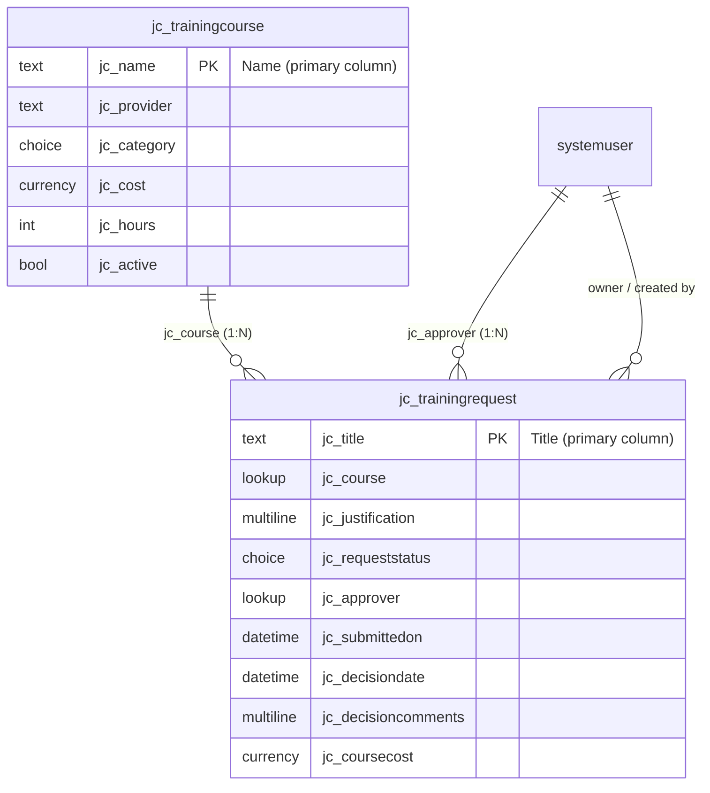

# Dataverse data model

Solution: **TrainingRequests** · Publisher prefix: **jc**

When you create each column, check **Advanced options → Schema name** so the logical names match
the ones below. The seed script (`seed_dataverse.py`), the flow expressions, and the Power BI
queries all use these names.



## Training Course (`jc_trainingcourse`)

Ownership: **User or team**. Display name: Training Course, plural Training Courses.

| Display name | Logical name | Type | Notes |
|---|---|---|---|
| Name | `jc_name` | Single line of text | Primary column, required |
| Provider | `jc_provider` | Single line of text | |
| Category | `jc_category` | Choice (local) | Technical, Leadership, Compliance, Professional Development |
| Cost | `jc_cost` | Currency | Required. Also creates `jc_cost_base` and `transactioncurrencyid` |
| Hours | `jc_hours` | Whole number | Required, min 1 (the estimate API divides by hours) |
| Active | `jc_active` | Yes/No | Default **Yes** |

## Training Request (`jc_trainingrequest`)

Ownership: **User or team**. This is required for User-level security. Display name: Training
Request, plural Training Requests.

For the primary column, open the **Primary column** tab in the new-table dialog. Set display name
to **Title**, then under **Advanced**, set schema name to `jc_Title`.

| Display name | Logical name | Type | Notes |
|---|---|---|---|
| Title | `jc_title` | Single line of text | Primary column, required |
| Course | `jc_course` | Lookup → Training Course | Required. Creates the 1:N relationship `jc_trainingcourse_jc_trainingrequest`. Set the relationship's **Delete** behavior to **Restrict**, so a course with requests can't be deleted |
| Justification | `jc_justification` | Multiple lines of text | Required when Course Cost > 1000 (business rule below) |
| Request Status | `jc_requeststatus` | Choice (local) | Draft, Submitted, Approved, Rejected, Completed, Error. Default **Draft** |
| Approver | `jc_approver` | Lookup → User | |
| Submitted On | `jc_submittedon` | Date and time | Behavior: User local |
| Decision Date | `jc_decisiondate` | Date and time | Behavior: User local |
| Decision Comments | `jc_decisioncomments` | Multiple lines of text | |
| Course Cost | `jc_coursecost` | Currency | Copy of the course cost at the time of the request. See below |

### Why the extra `Course Cost` column?

Business rules can only evaluate columns on their own table. They cannot read
`jc_course.jc_cost` through the lookup. The canvas app writes the selected course's cost into
`jc_coursecost` on save, and the business rule tests that column.

This also records the price at request time, so later catalog price changes don't rewrite past
spend. That's a reasonable design choice to explain in an interview.

### Choice values → write them down

Dataverse generates option values from your publisher's option-value prefix, for example
`123450000`. After creating **Request Status**, open the column → **Choices**, and record each
value. The flow trigger filter needs the **Submitted** value. The seed script's `--dry-run`
also prints them all.

| Label | Value (fill in) |
|---|---|
| Draft | |
| Submitted | |
| Approved | |
| Rejected | |
| Completed | |
| Error | |

## Business rule: Justification required over $1,000

Table **Training Request → Business rules → New**. Name: `Require justification over 1000`.
**Scope: Entity.** Entity scope makes the rule run on the server too, so it also applies to
saves from the canvas app, flows, the Web API, and imports.

```
IF   Course Cost  > 1000
AND  Justification  Does not contain data
THEN Set Business Required: Justification = Business Required
     Show Error Message: Justification = "Justification is required for courses over $1,000."
ELSE Set Business Required: Justification = Not Business Required
```

**Save → Validate → Activate.**

On the server, "Set Business Required" only affects forms. The **Show Error Message** action
is what blocks the save server-side. Test it by trying to save a request with Course Cost
2495 and an empty Justification from the canvas app. The form's `OnFailure` shows the
rule's message.

## Views (used by the model-driven app)

| Table | View | Filter | Columns |
|---|---|---|---|
| Training Course | **Active Courses** | Active = Yes | Name, Provider, Category, Cost, Hours |
| Training Request | **Pending Requests** | Request Status = Submitted | Title, Course, Owner, Approver, Submitted On, Course Cost. Sort by Submitted On ascending (oldest first) |
| Training Request | **Decided This Month** | Decision Date = This month | Title, Course, Request Status, Decision Date |

## Seed data

`seed/courses.csv` has 11 courses: 10 active and 1 inactive, so the Active filter has something
to exclude. `seed/requests.csv` has 28 requests from January to September 2026 with every status:
14 Approved, 4 Rejected, 4 Submitted, 3 Completed, 2 Draft, and 1 Error.

```bash
pip install -r dataverse/requirements.txt
python dataverse/seed_dataverse.py --env https://<org>.crm.dynamics.com --dry-run   # validate + print choice values
python dataverse/seed_dataverse.py --env https://<org>.crm.dynamics.com             # load
```

Seed **before** turning the approval flow on. Otherwise, the 4 Submitted rows start real approvals.
