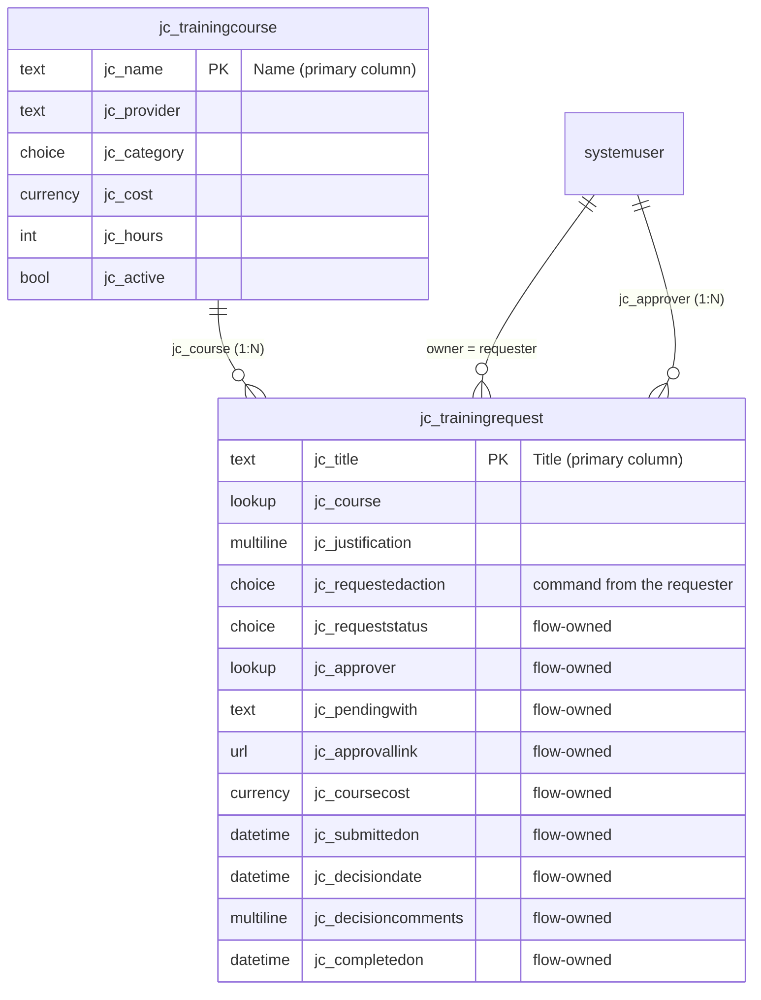
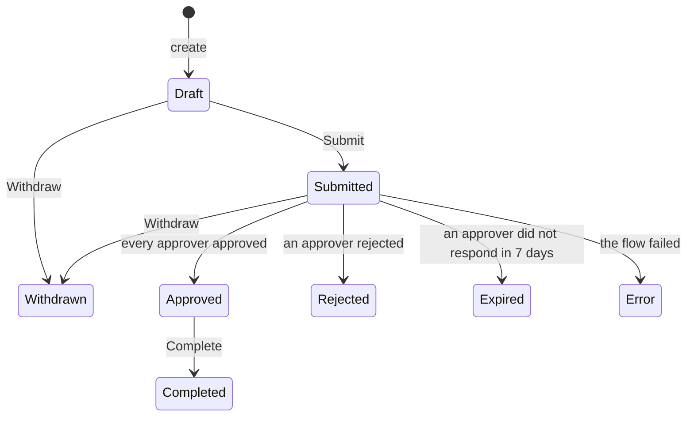

# Dataverse data model

Solution: **TrainingRequests** · Publisher prefix: **jc**

When you create each column, check **Advanced options → Schema name** so the logical names match
the ones below. The seed script (`seed_dataverse.py`), the flow expressions, and the Power BI
queries all use these names.



## Who writes what

A request has two kinds of columns, and the split is what makes approvals trustworthy:

- **Requester columns** (Title, Course, Justification, Requested Action). The owner of the row
  writes these in the canvas app. Course is set once, at creation.
- **Flow-owned columns** (everything marked *Flow-owned* below). Only the flows and admins can
  write them. They are protected with **column-level security**, so an employee cannot set their
  own request to Approved through the app, the Web API, or an Excel import. See
  [`security-roles.md`](security-roles.md).

The requester never writes Request Status. They write a **command** into Requested Action
(Submit, Withdraw, or Complete), and a flow checks that the command is allowed from the current
status before applying it:



Every status except Draft and Submitted is final. To try again after Rejected, Withdrawn, Expired,
or Error, the requester starts a new request (the canvas app has a **Request again** button that
pre-fills it). Because a row is submitted at most once, a late response to an old approval can
never be mistaken for a decision on a newer submission.

## Training Course (`jc_trainingcourse`)

Ownership: **User or team**. Display name: Training Course, plural Training Courses.

| Display name | Logical name | Type | Notes |
|---|---|---|---|
| Name | `jc_name` | Single line of text | Primary column, required |
| Provider | `jc_provider` | Single line of text | |
| Category | `jc_category` | Choice (local) | Technical, Leadership, Compliance, Professional Development |
| Cost | `jc_cost` | Currency | Required. Also creates `jc_cost_base` and `transactioncurrencyid` |
| Hours | `jc_hours` | Whole number | Required, min 1, max 10000 (the estimate API divides by hours and rejects anything outside this range) |
| Active | `jc_active` | Yes/No | Default **Yes** |

## Training Request (`jc_trainingrequest`)

Ownership: **User or team**. This is required for User-level security, and the **owner is the
requester** everywhere: the security roles, the canvas app's *My Requests* filter, the flow's
emails, and the Power BI *Requester* dimension all read Owner.

For the primary column, open the **Primary column** tab in the new-table dialog. Set display name
to **Title**, then under **Advanced**, set schema name to `jc_Title`.

### Requester columns

| Display name | Logical name | Type | Notes |
|---|---|---|---|
| Title | `jc_title` | Single line of text | Primary column, required |
| Course | `jc_course` | Lookup → Training Course | Required. Creates the 1:N relationship `jc_trainingcourse_jc_trainingrequest`. Set the relationship's **Delete** behavior to **Restrict**, so a course with requests can't be deleted. **Enable column security**: the requester sets it when creating the request and cannot change it afterwards, so an approved request can't be pointed at a different course |
| Justification | `jc_justification` | Multiple lines of text | Required when Course Cost > 1000 (business rule below) |
| Requested Action | `jc_requestedaction` | Choice (local) | **Submit, Withdraw, Complete**. No default (blank = nothing requested). The flows clear it once they have handled it |

### Flow-owned columns

Turn on **Advanced options → Enable column security** for every column in this table.

| Display name | Logical name | Type | Written by | Notes |
|---|---|---|---|---|
| Request Status | `jc_requeststatus` | Choice (local) | All three flows | Draft, Submitted, Approved, Rejected, Completed, Error, Withdrawn, Expired. Default **Draft** |
| Approver | `jc_approver` | Lookup → User | Approval flow | The requester's manager, resolved at submit time. The requester does not choose it |
| Pending With | `jc_pendingwith` | Single line of text (Email) | Approval flow | Email of whoever the request is waiting on right now: the manager, then the second approver. Blank when nothing is pending |
| Approval Link | `jc_approvallink` | Single line of text (URL), max length 1000 | Approval flow | Link that opens the pending approval. The canvas app's **Review** button launches it |
| Course Cost | `jc_coursecost` | Currency | Approval flow | The catalog price at submit time. See below |
| Submitted On | `jc_submittedon` | Date and time | Approval flow | Behavior: User local |
| Decision Date | `jc_decisiondate` | Date and time | Approval flow | Set only for Approved and Rejected. Behavior: User local |
| Decision Comments | `jc_decisioncomments` | Multiple lines of text | All three flows | Approver comments, or the reason for Withdrawn / Expired / Error |
| Completed On | `jc_completedon` | Date and time | Commands flow | Behavior: User local |

### Why the extra `Course Cost` column?

Business rules can only evaluate columns on their own table. They cannot read
`jc_course.jc_cost` through the lookup. The approval flow copies the catalog price into
`jc_coursecost` when the request is submitted, and the business rule tests that column.

This also records the price at request time, so later catalog price changes don't rewrite past
spend. And because the flow copies it rather than the app, the number that drives the second
approval, the business rule, and the spend report is always the catalog's, never one a client
supplied.

### Choice values → write them down

Dataverse generates option values from your publisher's option-value prefix, for example
`123450000`. After creating the two choice columns, open each column → **Choices** and record the
values. The flow trigger filters and conditions need them. The seed script's `--dry-run` also
prints them all.

| Request Status | Value (fill in) | | Requested Action | Value (fill in) |
|---|---|---|---|---|
| Draft | | | Submit | |
| Submitted | | | Withdraw | |
| Approved | | | Complete | |
| Rejected | | | | |
| Completed | | | | |
| Error | | | | |
| Withdrawn | | | | |
| Expired | | | | |

The flow specs write these as `<DRAFT>`, `<SUBMITTED>`, `<SUBMIT>`, and so on. Replace each
placeholder with the number from this table.

## Business rule: Justification required over $1,000

Table **Training Request → Business rules → New**. Name: `Require justification over 1000`.
**Scope: Entity.** Entity scope makes the rule run on the server too, so it also applies to
saves from flows, the Web API, and imports.

```
IF   Course Cost  > 1000
AND  Justification  Does not contain data
THEN Set Business Required: Justification = Business Required
     Show Error Message: Justification = "Justification is required for courses over $1,000."
ELSE Set Business Required: Justification = Not Business Required
```

**Save → Validate → Activate.**

On the server, "Set Business Required" only affects forms. The **Show Error Message** action
is what blocks the save server-side.

Course Cost is stamped by the approval flow, so this rule fires when the *flow* writes the cost.
The canvas app checks the same condition before it lets the user submit, so an honest user never
gets that far. If a client bypasses the app and submits an expensive request with no justification,
the flow's update is rejected, the request goes to **Error**, and Decision Comments carries the
rule's message. Test it that way: see test 8 in [`../flow/approval-flow.md`](../flow/approval-flow.md).

### The $1,000 threshold

The threshold has one owner and two copies that must follow it:

| Where | Role |
|---|---|
| Estimate API, `HIGH_COST_THRESHOLD` (default 1000) | **Source of truth.** Decides whether a second approval is required, and returns the value as `high_cost_threshold` |
| Canvas app | Reads `high_cost_threshold` from the API response. `fxFallbackThreshold` is used only while the API is unreachable |
| This business rule | Server-side backstop. Business rules can't read environment variables, so the literal `1000` must be edited by hand |

If you change the threshold, change the API setting, then this rule, then `fxFallbackThreshold`.

## Views (used by the model-driven app)

| Table | View | Filter | Columns |
|---|---|---|---|
| Training Course | **Active Courses** | Active = Yes | Name, Provider, Category, Cost, Hours |
| Training Request | **Pending Requests** | Request Status = Submitted | Title, Course, Owner, Pending With, Submitted On, Course Cost. Sort by Submitted On ascending (oldest first) |
| Training Request | **Decided This Month** | Decision Date = This month | Title, Course, Owner, Request Status, Decision Date |
| Training Request | **Needs Attention** | Request Status = Error **OR** (Requested Action contains data **AND** Modified On older than 1 hour) | Title, Owner, Request Status, Requested Action, Decision Comments, Modified On |

*Needs Attention* is the admin's safety net. A command that has sat unhandled for an hour means a
flow is turned off or failing before it can report, and Error rows carry the failure reason.

## Seed data

`seed/courses.csv` has 11 courses: 10 active and 1 inactive, so the Active filter has something
to exclude. `seed/requests.csv` has 30 requests from January to September 2026 with every status:
14 Approved, 4 Rejected, 4 Submitted, 3 Completed, 2 Draft, and 1 each of Error, Withdrawn, and
Expired.

```bash
pip install -r dataverse/requirements.txt
python dataverse/seed_dataverse.py --check                                        # validate the CSVs offline
python dataverse/seed_dataverse.py --env https://<org>.crm.dynamics.com --dry-run # print choice values
python dataverse/seed_dataverse.py --env https://<org>.crm.dynamics.com           # load
```

- **Safe to re-run.** Rows that already exist (matched by course name / request title) are skipped.
- **`--reset`** deletes only the seeded rows, asks you to type the environment host first, and
  leaves anything created in the apps alone.
- **It never starts an approval.** Seeding writes Request Status directly and leaves Requested
  Action blank, and only Requested Action triggers the flows. The four seeded Submitted rows are
  display data: they show in the *Waiting on me* queue but have no approval behind them, and the
  reminder flow skips them because they have no Approval Link.
- The account you sign in with must be able to write the flow-owned columns: System Administrator,
  or the *Training - Write Decision Fields* column security profile.
