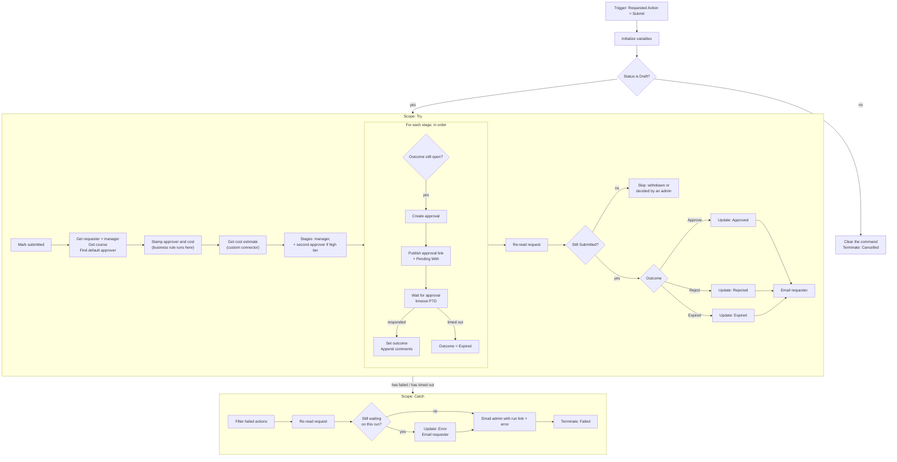

# Flow: Training Request Approval

**TrainingRequests → New → Automation → Cloud flow → Automated**, name
`Training Request Approval`. Creating it inside the solution means its connections are stored as
**connection references**, so the flow can be imported into another environment and re-pointed
without editing it.

This is one of three flows. The other two are small:
[`commands-flow.md`](commands-flow.md) (Withdraw and Complete) and
[`reminders-flow.md`](reminders-flow.md) (daily nudge to approvers).

> **Rename every action exactly as written below before you write expressions that refer to it.**
> Expressions refer to actions by name, with spaces replaced by underscores. For example, an action
> named `Get course` is `outputs('Get_course')`.

> **Choice values.** `<DRAFT>`, `<SUBMITTED>`, `<SUBMIT>` and the like stand for the numbers you
> recorded in [`../dataverse/schema.md`](../dataverse/schema.md#choice-values--write-them-down).

## What this flow is responsible for

The flow is the **only** thing that moves a request out of Draft and the only thing that records a
decision. Requesters cannot write those columns (column security), and there is no approve button
in the app that writes to the row. Every decision goes through an approval that this flow created,
whether the approver answers in Outlook, in Teams, or by pressing **Review** in the canvas app
(which opens the same approval).

That single path is what guarantees three things:

- a high-cost request always gets its second approval,
- the requester is always emailed the outcome,
- the approver is the requester's manager, never someone the requester picked.

## Environment variables (create in the solution first)

| Schema name | Type | Example value | Used by |
|---|---|---|---|
| `jc_EstimateApiHost` | Text | `training-estimate-api.onrender.com` | Custom connector host |
| `jc_DefaultApproverEmail` | Text | your email | Stage-1 approver when the requester has no manager on file. Must be a user in the environment |
| `jc_SecondApproverEmail` | Text | your email | Stage-2 approval for high-tier requests |
| `jc_AdminEmail` | Text | your email | Catch-path alert |
| `jc_EnvironmentUrl` | Text | `https://<org>.crm.dynamics.com` | Record link in the approval |

In the flow designer, environment variables appear in dynamic content under **Environment
variables**.

**Where the manager comes from.** The flow reads the **Manager** field on the requester's Dataverse
user record (`parentsystemuserid`). Set it in **admin center → Environment → Settings → Users →
(user) → Change manager**. A user without a manager falls back to `jc_DefaultApproverEmail`.

In a single-user developer environment you are requester, manager, and second approver at once, so
you approve your own requests. That is a property of the tenant, not of the design: with a manager
on file the requester cannot influence who approves.

## Diagram



## Trigger: Dataverse *When a row is added, modified or deleted*

| Setting | Value |
|---|---|
| Change type | **Added or Modified** |
| Table name | Training Requests |
| Scope | **Organization** |
| Select columns | `jc_requestedaction` |
| Filter rows | `jc_requestedaction eq <SUBMIT>` |

- **Added or Modified**, because *Submit* on a brand-new request arrives as an Add, and submitting a
  saved draft arrives as a Modify.
- **Select columns** means the flow runs only when Requested Action changes. None of the flow's own
  updates can re-trigger it: the first thing it does is clear the command, and a blank command
  doesn't match the filter.

## Top-level actions (before Try)

`Initialize variable` actions must sit at the top level, not inside a scope.

| Name | Type | Value |
|---|---|---|
| `Init varOutcome` | String | `Pending` |
| `Init varComments` | String | *(empty)* |
| `Init varStageLabel` | String | *(empty)* |

**`Can submit?`**: *Condition*
- `coalesce(triggerOutputs()?['body/jc_requeststatus'], <DRAFT>)` **is equal to** `<DRAFT>`

  **If no:** the command isn't valid from this status (for example, Submit on a request that is
  already Approved).
  - `Ignore command`: Dataverse *Update a row*, Row ID
    `triggerOutputs()?['body/jc_trainingrequestid']`, **Requested Action** = expression `null`
  - `Terminate ignored`: *Terminate*, status **Cancelled**

  **If yes:** *(empty)*

> To clear a choice or text column in *Update a row*, switch the field to **Enter custom value**
> (choices) and type `null` in the **Expression** tab. Leaving the field empty means "don't change it".

## Scope: `Try`

**1. `Mark submitted`**: Dataverse *Update a row*, Training Requests,
Row ID `triggerOutputs()?['body/jc_trainingrequestid']`
- Request Status: **Submitted**
- Submitted On: `utcNow()`
- Requested Action: `null`

This comes first so the requester sees *Submitted* within seconds, before the slower lookups run.

**2. `Get requester`**: Dataverse *Get a row by ID*
- Table: Users · Row ID: `triggerOutputs()?['body/_ownerid_value']`
- Select columns: `fullname,internalemailaddress`
- Expand Query: `parentsystemuserid($select=systemuserid,fullname,internalemailaddress)`

The requester is the row's **owner**. A request owned by a team has no manager to ask and fails
here, which is the intended outcome.

**3. `Get course`**: Dataverse *Get a row by ID*
- Table: Training Courses · Row ID: `triggerOutputs()?['body/_jc_course_value']`
- Select columns: `jc_name,jc_cost,jc_hours`

**4. `Find default approver`**: Dataverse *List rows*
- Table: Users
- Filter rows: `internalemailaddress eq '@{parameters('Default Approver Email (jc_DefaultApproverEmail)')}'`
- Select columns: `systemuserid,fullname,internalemailaddress` · Row count: `1`

**5. `Compose approver`**: *Compose*. The manager if there is one, otherwise the default approver:
```
if(
  empty(outputs('Get_requester')?['body/parentsystemuserid']),
  first(outputs('Find_default_approver')?['body/value']),
  outputs('Get_requester')?['body/parentsystemuserid']
)
```

**6. `Stamp approver and cost`**: Dataverse *Update a row*, same Row ID
- Approver (Users): `systemusers(@{outputs('Compose_approver')?['systemuserid']})`
- Course Cost: `outputs('Get_course')?['body/jc_cost']`

Stamping the **catalog** cost here, server-side, is what makes it authoritative: the tier, the
business rule, and the spend report all read this one value. The justification business rule is
evaluated on this update. If it rejects the write, Try fails and Catch records the rule's message.

**7. `Get cost estimate`**: Training Estimate *Get cost estimate* (custom connector)
- Cost: `outputs('Get_course')?['body/jc_cost']`
- Hours: `outputs('Get_course')?['body/jc_hours']`
- **Settings → Retry policy:** Exponential, count 3, interval `PT20S`. This covers Render's cold start.

**8. `Compose all stages`**: *Compose*. Paste as JSON, then replace the two emails with dynamic content:
```json
[
  { "label": "Manager", "email": "@{outputs('Compose_approver')?['internalemailaddress']}" },
  { "label": "Second approver", "email": "@{parameters('Second Approver Email (jc_SecondApproverEmail)')}" }
]
```

**9. `Compose stages`**: *Compose*. Both stages for a high-tier request, otherwise only the first:
```
if(
  equals(body('Get_cost_estimate')?['requires_second_approval'], true),
  outputs('Compose_all_stages'),
  take(outputs('Compose_all_stages'), 1)
)
```

The custom connector is doing real routing here. Requests that the API tiers as `high` need two
approvals, and nothing else in the system decides that.

**10. `For each stage`**: *Apply to each* over `outputs('Compose_stages')`
- **Settings → Concurrency control: On, degree of parallelism 1.** The stages must run in order.

Inside the loop:

**`Stage still open?`**: *Condition*
- `variables('varOutcome')` **is not equal to** `Reject`
- **AND** `variables('varOutcome')` **is not equal to** `Expired`

A rejection or a timeout at stage 1 means stage 2 is never asked.

  **If yes:**

  a. **`Set stage label`**: *Set variable* `varStageLabel` = `items('For_each_stage')?['label']`

  b. **`Create approval`**: Approvals *Create an approval* (this one does **not** wait)
  - Approval type: **Approve/Reject – First to respond**
  - Title: `Training request (@{items('For_each_stage')?['label']}): @{outputs('Get_course')?['body/jc_name']}`
  - Assigned to: `items('For_each_stage')?['email']`
  - Details (Markdown):
    ```
    **Requester:** @{outputs('Get_requester')?['body/fullname']}
    **Course:** @{outputs('Get_course')?['body/jc_name']}
    **Cost:** $@{outputs('Get_course')?['body/jc_cost']}  (@{body('Get_cost_estimate')?['cost_per_hour']}/hr, @{body('Get_cost_estimate')?['tier']} tier)
    **Hours:** @{outputs('Get_course')?['body/jc_hours']}

    **Justification:**
    @{triggerOutputs()?['body/jc_justification']}

    **Earlier approvals:**
    @{if(empty(variables('varComments')), 'None. You are the first approver.', variables('varComments'))}
    ```
  - Item link: `@{parameters('Environment URL (jc_EnvironmentUrl)')}/main.aspx?pagetype=entityrecord&etn=jc_trainingrequest&id=@{triggerOutputs()?['body/jc_trainingrequestid']}`
  - Item link description: `Open request`

  c. **`Publish approval link`**: Dataverse *Update a row*, same Row ID
  - Pending With: `items('For_each_stage')?['email']`
  - Approval Link: the **Respond link** dynamic content from `Create approval`
    (`outputs('Create_approval')?['body/respondLink']`)

  This is what lets the canvas app show *who* a request is waiting on and open the approval
  directly. It is also why the action is split into *Create* and *Wait*: the combined *Start and
  wait for an approval* gives you no link until the approver has already answered.

  d. **`Wait for approval`**: Approvals *Wait for an approval*
  - Approval ID: the **Approval ID** dynamic content from `Create approval`
    (`outputs('Create_approval')?['body/name']`)
  - **Settings → Timeout: `P7D`**. Without a timeout, an approval can wait up to the platform limit
    of 30 days while the run holds its resources.

  e. After `Wait for approval`, add **two parallel branches** (**+ → Add a parallel branch**):

  | Branch | Runs after `Wait for approval`… | Actions |
  |---|---|---|
  | Responded | **is successful** (the default) | `Set outcome`: *Set variable* `varOutcome` = `outputs('Wait_for_approval')?['body/outcome']`<br/>`Append comments`: *Append to string variable* `varComments`, value below |
  | No response | **has timed out** only (**… → Configure run after**, clear *is successful*) | `Set outcome expired`: *Set variable* `varOutcome` = `Expired` |

  `Append comments` value:
  ```
  @{items('For_each_stage')?['label']}: @{coalesce(first(outputs('Wait_for_approval')?['body/responses'])?['comments'], '(no comment)')}
  ```
  followed by a line break, so each approver's comment sits on its own line.

  A timeout is a normal business outcome with its own status, not an error. Because the *No
  response* branch handles it, the loop and the Try scope still succeed. A genuine failure of the
  approval action (for example, the assignee's mailbox doesn't exist) matches neither branch, so it
  fails the scope and goes to Catch.

  **If no:** *(empty)*

**11. `Re-read request`**: Dataverse *Get a row by ID*
- Table: Training Requests · Row ID: `triggerOutputs()?['body/jc_trainingrequestid']`
- Select columns: `jc_requeststatus`

**12. `Still pending?`**: *Condition*: `outputs('Re-read_request')?['body/jc_requeststatus']`
**is equal to** `<SUBMITTED>`

Up to 14 days can pass between `Mark submitted` and this point. In that time the requester may have
withdrawn the request, or an admin may have settled it in the model-driven app. Whatever happened to
the row since then wins, and a late response to this run's approval is ignored.

  **If no:** *(empty)*

  **If yes:**

  - **`Record outcome`**: *Switch* on `variables('varOutcome')`. Every case is a Dataverse
    *Update a row* on the same Row ID that also clears **Pending With** and **Approval Link**
    (expression `null`).

    | Case | Action name | Request Status | Decision Date | Decision Comments |
    |---|---|---|---|---|
    | `Approve` | `Update approved` | **Approved** | `utcNow()` | `variables('varComments')` |
    | `Reject` | `Update rejected` | **Rejected** | `utcNow()` | `variables('varComments')` |
    | `Expired` | `Update expired` | **Expired** | *(leave empty)* | `No response from the @{variables('varStageLabel')} within 7 days.` then a line break and `@{variables('varComments')}` |
    | Default | `Update unexpected` | **Error** | *(leave empty)* | `Unexpected approval outcome: @{variables('varOutcome')}` |

  - **`Compose outcome text`**: *Compose*
    ```
    if(equals(variables('varOutcome'), 'Approve'), 'approved',
      if(equals(variables('varOutcome'), 'Reject'), 'rejected',
        if(equals(variables('varOutcome'), 'Expired'), 'not answered in time', 'not processed')))
    ```
  - **`Email requester`**: Office 365 Outlook *Send an email (V2)*
    - To: `outputs('Get_requester')?['body/internalemailaddress']`
    - Subject: `Your training request was @{outputs('Compose_outcome_text')}: @{outputs('Get_course')?['body/jc_name']}`
    - Body:
      ```
      Hi @{outputs('Get_requester')?['body/fullname']},

      Your request "@{triggerOutputs()?['body/jc_title']}" for @{outputs('Get_course')?['body/jc_name']}
      was @{toUpper(outputs('Compose_outcome_text'))}.

      @{if(equals(variables('varOutcome'), 'Expired'), concat('Your ', toLower(variables('varStageLabel')), ' did not respond within 7 days. Open the Training Portal and use "Request again" once you have spoken to them.'), '')}

      Comments:
      @{variables('varComments')}
      ```

## Scope: `Catch`

Add it **below** Try (not inside). Open **… → Configure run after**, clear *is successful*, and check
**has failed** and **has timed out**.

Catch handles real failures only: a Dataverse error, the business rule rejecting the cost stamp, the
estimate API being down after three retries, an approval that could not be created. An approver not
answering is handled inside Try.

**1. `Failed actions`**: Data Operation *Filter array*
- From: `result('Try')`
- Condition (advanced mode):
  `@or(equals(item()?['status'], 'Failed'), equals(item()?['status'], 'TimedOut'))`

**2. `Compose error`**: *Compose*. Paste this into the expression editor as one expression:
```
concat(
  'Failed action: ', first(body('Failed_actions'))?['name'],
  ' (', first(body('Failed_actions'))?['status'], ')',
  if(empty(variables('varStageLabel')), '', concat(' at stage "', variables('varStageLabel'), '"')),
  ': ',
  coalesce(
    first(body('Failed_actions'))?['error']?['message'],
    first(body('Failed_actions'))?['outputs']?['body']?['error']?['message'],
    'Unknown error'
  )
)
```

**3. `Compose run link`**: *Compose*
```
concat('https://make.powerautomate.com/environments/', workflow()?['tags']?['environmentName'],
       '/flows/', workflow()?['name'], '/runs/', workflow()?['run']?['name'])
```

**4. `Re-read after failure`**: Dataverse *Get a row by ID*
- Table: Training Requests · Row ID: `triggerOutputs()?['body/jc_trainingrequestid']`
- Select columns: `jc_requeststatus,jc_requestedaction`

**5. `Still waiting on this run?`**: *Condition* (one expression, **is equal to** `true`):
```
or(
  equals(outputs('Re-read_after_failure')?['body/jc_requeststatus'], <SUBMITTED>),
  equals(outputs('Re-read_after_failure')?['body/jc_requestedaction'], <SUBMIT>)
)
```

The first half covers a failure after `Mark submitted`. The second covers a failure *of*
`Mark submitted`, where the row is still a Draft with the command set. If neither is true, the
request was withdrawn or settled by an admin while this run was waiting, and its status must be left
alone.

  **If yes:**
  - **`Update error`**: Dataverse *Update a row*, same Row ID
    - Request Status: **Error**
    - Requested Action, Pending With, Approval Link: `null`
    - Decision Comments: `Automated approval failed: @{outputs('Compose_error')}`
  - **`Get owner`**: Dataverse *Get a row by ID*, Users, Row ID
    `triggerOutputs()?['body/_ownerid_value']`, select `fullname,internalemailaddress`. Don't reuse
    `Get requester` here, because that may be the action that failed.
  - **`Email requester about error`**: *Send an email (V2)*
    - To: `outputs('Get_owner')?['body/internalemailaddress']`
    - Subject: `Your training request could not be processed: @{triggerOutputs()?['body/jc_title']}`
    - Body: `outputs('Compose_error')`, and one line: *Open the Training Portal and use "Request
      again" after fixing the problem above, or contact the training team.*

  **If no:** *(empty)*

**6. `Email admin`**: *Send an email (V2)*
- To: env var **Admin Email**
- Subject: `[Training Portal] Approval flow failed: @{triggerOutputs()?['body/jc_title']}`
- Body: request title and ID, `outputs('Compose_error')`, and `outputs('Compose_run_link')` as a link.

**7. `Terminate`**: *Terminate*, status **Failed**, code `TryFailed`, message
`outputs('Compose_error')`. Without this, the run shows **Succeeded** because Catch handled
the error, and it wouldn't show up in failure monitoring or alerts.

### Notes on `result('Try')`

- It returns only the **direct children** of the scope. If an action nested inside the loop fails,
  the failed entry is `For_each_stage` itself, and its error message is generic (`ActionFailed`).
  `varStageLabel` in the message tells you which approver the run was dealing with, and the run link
  in the email takes you to the real failing action.
- The filter checks `TimedOut` as well as `Failed` because the scope as a whole can time out (a flow
  run ends after 30 days).

## Testing checklist

Run these as a **non-admin** test user with a manager on file where the test says so (see
[`../dataverse/security-roles.md`](../dataverse/security-roles.md#testing)).

| # | Test | Expected |
|---|---|---|
| 1 | Submit a $165 course from the canvas app. Approve in Outlook/Teams | Status flips to Submitted in seconds, with Approver and Course Cost filled in. Then Approved, Decision Date set, requester email |
| 2 | Submit, then press **Review** on the app's Approvals screen and reject with a comment | The approval opens. Status → Rejected, comment copied, Pending With and Approval Link cleared |
| 3 | Submit a $2,495 course and approve as manager | Pending With changes to the second approver, who gets an approval showing the manager's comment. Final status follows stage 2 |
| 4 | Submit a $2,495 course and **reject** as manager | Rejected. The second approver is never asked |
| 5 | Save as Draft | Flow does **not** run. Then open the draft and Submit: flow runs |
| 6 | Submit, then **Withdraw** in the app, then answer the approval anyway | Status stays Withdrawn. This run finishes Succeeded without writing |
| 7 | **Timeout:** temporarily set `Wait for approval` timeout to `PT2M` and don't respond | After ~2 min: status **Expired**, requester email says no response, run **Succeeded** |
| 8 | **Business rule:** through the Web API, create a request for a $2,495 course with no justification and `jc_requestedaction` = Submit | Status **Error**, Decision Comments contains "Justification is required…", admin email, run Failed |
| 9 | **Break it:** temporarily point `jc_EstimateApiHost` at a host that doesn't exist and submit | After the retries: status **Error**, admin email with run link and "Failed action: Get_cost_estimate", run marked Failed |
| 10 | As the requester, set `jc_requestedaction` = Submit on a request that is already Approved | Command cleared, status unchanged, run Cancelled |
| 11 | Requester with a manager on file | The approval goes to that manager, not to the default approver |

Restore the settings after tests 7 and 9. Take a screenshot of the failed run from test 9 for the
README (`docs/screenshots/flow-catch.png`).
