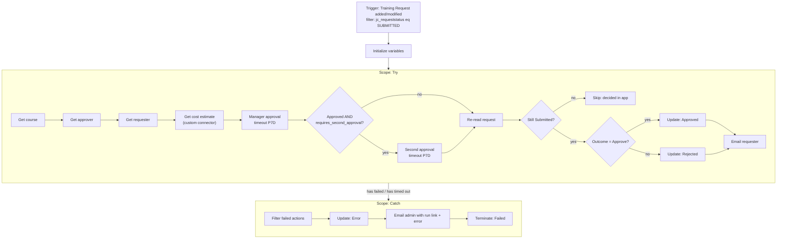

# Flow: Training Request Approval

**TrainingRequests → New → Automation → Cloud flow → Automated**, name
`Training Request Approval`. Creating it inside the solution means its connections are stored as
**connection references**, so the flow can be imported into another environment and re-pointed
without editing it.

> **Rename every action exactly as written below before you write expressions that refer to it.**
> Expressions refer to actions by name, with spaces replaced by underscores. For example, an action
> named `Get course` is `outputs('Get_course')`.

## Environment variables (create in the solution first)

| Schema name | Type | Example value | Used by |
|---|---|---|---|
| `jc_EstimateApiHost` | Text | `training-estimate-api.onrender.com` | Custom connector host |
| `jc_SecondApproverEmail` | Text | your email | Stage-2 approval for high-tier requests |
| `jc_AdminEmail` | Text | your email | Catch-path alert |
| `jc_EnvironmentUrl` | Text | `https://<org>.crm.dynamics.com` | Record link in the approval |

In the flow designer, environment variables appear in dynamic content under **Environment
variables**.

## Diagram



## Trigger: Dataverse *When a row is added, modified or deleted*

| Setting | Value |
|---|---|
| Change type | **Added or Modified** |
| Table name | Training Requests |
| Scope | **Organization** |
| Select columns | `jc_requeststatus` |
| Filter rows | `jc_requeststatus eq 123450001` ← replace with your **Submitted** value |

> **Changed from the notes:** the notes say *Modified*. However, the canvas app creates the row
> already in `Submitted`, which is an **Add**, so a Modified-only trigger would never fire for new
> requests. **Select columns** means the flow runs only when the status column changes. The flow's own
> update to Approved/Rejected no longer matches the filter, so the flow can't loop.

## Top-level actions (before Try)

`Initialize variable` actions must sit at the top level, not inside a scope.

| Name | Type | Value |
|---|---|---|
| `Init varOutcome` | String | `Pending` |
| `Init varComments` | String | *(empty)* |

## Scope: `Try`

**1. `Get course`**: Dataverse *Get a row by ID*
- Table: Training Courses
- Row ID: `triggerOutputs()?['body/_jc_course_value']`
- Select columns: `jc_name,jc_cost,jc_hours`

**2. `Get approver`**: Dataverse *Get a row by ID*
- Table: Users · Row ID: `triggerOutputs()?['body/_jc_approver_value']`
- Select columns: `fullname,internalemailaddress`

**3. `Get requester`**: Dataverse *Get a row by ID*
- Table: Users · Row ID: `triggerOutputs()?['body/_createdby_value']`
- Select columns: `fullname,internalemailaddress`

**4. `Get cost estimate`**: Training Estimate *Get cost estimate* (custom connector)
- Cost: `outputs('Get_course')?['body/jc_cost']`
- Hours: `outputs('Get_course')?['body/jc_hours']`
- **Settings → Retry policy:** Exponential, count 3, interval `PT20S`. This covers Render's cold start.

**5. `Manager approval`**: Approvals *Start and wait for an approval*
- Approval type: **Approve/Reject – First to respond**
- Title: `Training request: @{outputs('Get_course')?['body/jc_name']}`
- Assigned to: `outputs('Get_approver')?['body/internalemailaddress']`
- Details (Markdown):
  ```
  **Requester:** @{outputs('Get_requester')?['body/fullname']}
  **Course:** @{outputs('Get_course')?['body/jc_name']}
  **Cost:** $@{outputs('Get_course')?['body/jc_cost']}  (@{body('Get_cost_estimate')?['cost_per_hour']}/hr, @{body('Get_cost_estimate')?['tier']} tier)
  **Hours:** @{outputs('Get_course')?['body/jc_hours']}

  **Justification:**
  @{triggerOutputs()?['body/jc_justification']}
  ```
- Item link: `@{parameters('Environment URL (jc_EnvironmentUrl)')}/main.aspx?pagetype=entityrecord&etn=jc_trainingrequest&id=@{triggerOutputs()?['body/jc_trainingrequestid']}`
- Item link description: `Open request`
- **Settings (… → Settings) → Timeout: `P7D`**. After 7 days, the action times out, the Try
  scope reports **TimedOut**, and the Catch scope runs. Without a timeout, an approval can wait up to
  the platform limit of 30 days while the run holds its resources.

**6. `Set outcome`**: *Set variable* `varOutcome` = `outputs('Manager_approval')?['body/outcome']`

**7. `Set comments`**: *Set variable* `varComments` =
`coalesce(first(outputs('Manager_approval')?['body/responses'])?['comments'], '')`

**8. `Needs second approval`**: *Condition*
- `variables('varOutcome')` **is equal to** `Approve`
- **AND** `body('Get_cost_estimate')?['requires_second_approval']` **is equal to** `true`

  **If yes:**
  - `Second approval`: *Start and wait for an approval*, Approve/Reject – First to respond.
    Assigned to: env var **Second Approver Email**. Title: `High-cost training (2nd approval): @{outputs('Get_course')?['body/jc_name']}`.
    Details: same as the manager approval plus `Manager comments: @{variables('varComments')}`.
    Timeout **P7D**.
  - `Set outcome 2`: `varOutcome` = `outputs('Second_approval')?['body/outcome']`
  - `Set comments 2`: `varComments` =
    `concat(variables('varComments'), ' | 2nd approver: ', coalesce(first(outputs('Second_approval')?['body/responses'])?['comments'], ''))`

  **If no:** *(empty)*

The custom connector is doing real routing here, not decoration. Requests that the API tiers as
`high` (cost > $1,000) need two approvals.

**9. `Re-read request`**: Dataverse *Get a row by ID*
- Table: Training Requests · Row ID: `triggerOutputs()?['body/jc_trainingrequestid']`
- Select columns: `jc_requeststatus`

**10. `Still pending`**: *Condition*: `outputs('Re-read_request')?['body/jc_requeststatus']`
**is equal to** `123450001` (your Submitted value)

  **If no:** *(empty)*. The manager already decided in the canvas app. The app's decision stands
  and the late email response is ignored.

  **If yes:**
  - `Approved?`: *Condition*: `variables('varOutcome')` **is equal to** `Approve`
    - **Yes → `Update approved`**: Dataverse *Update a row*, Training Requests,
      Row ID `triggerOutputs()?['body/jc_trainingrequestid']`
      - Request Status: **Approved**
      - Decision Date: `utcNow()`
      - Decision Comments: `variables('varComments')`
    - **No → `Update rejected`**: same, with Request Status **Rejected**
  - `Email requester`: Office 365 Outlook *Send an email (V2)*
    - To: `outputs('Get_requester')?['body/internalemailaddress']`
    - Subject: `Your training request was @{if(equals(variables('varOutcome'),'Approve'),'approved','rejected')}: @{outputs('Get_course')?['body/jc_name']}`
    - Body:
      ```
      Hi @{outputs('Get_requester')?['body/fullname']},

      Your request "@{triggerOutputs()?['body/jc_title']}" for @{outputs('Get_course')?['body/jc_name']}
      was @{if(equals(variables('varOutcome'),'Approve'),'APPROVED','REJECTED')}.

      Comments: @{variables('varComments')}
      ```

## Scope: `Catch`

Add it **below** Try (not inside). Open **… → Configure run after**, clear *is successful*, and check
**has failed** and **has timed out**.

**1. `Failed actions`**: Data Operation *Filter array*
- From: `result('Try')`
- Condition (advanced mode):
  `@or(equals(item()?['status'], 'Failed'), equals(item()?['status'], 'TimedOut'))`

**2. `Compose error`**: *Compose*. Paste this into the expression editor as one expression:
```
concat(
  'Failed action: ', first(body('Failed_actions'))?['name'],
  ' (', first(body('Failed_actions'))?['status'], '): ',
  coalesce(
    first(body('Failed_actions'))?['error']?['message'],
    first(body('Failed_actions'))?['outputs']?['body']?['error']?['message'],
    'Unknown error'
  )
)
```

**3. `Compose run link`**: *Compose*
```
concat('https://make.powerautomate.com/environments/', workflow()?['tags']?['environmentName'],
       '/flows/', workflow()?['name'], '/runs/', workflow()?['run']?['name'])
```

**4. `Update error`**: Dataverse *Update a row*
- Row ID: `triggerOutputs()?['body/jc_trainingrequestid']`
- Request Status: **Error**
- Decision Comments: `Automated approval failed: @{outputs('Compose_error')}`

**5. `Email admin`**: *Send an email (V2)*
- To: env var **Admin Email**
- Subject: `[Training Portal] Approval flow failed: @{triggerOutputs()?['body/jc_title']}`
- Body: request title and ID, `outputs('Compose_error')`, and `outputs('Compose_run_link')` as a link.

**6. `Terminate`**: *Terminate*, status **Failed**, code `TryFailed`, message
`outputs('Compose_error')`. Without this, the run shows **Succeeded** because Catch handled
the error, and it wouldn't show up in failure monitoring or alerts.

### Notes on `result('Try')`

- It returns only the **direct children** of the scope. If an action nested inside a Condition
  fails, the failed entry is the *Condition* itself, and its error message is generic
  (`ActionFailed`). The run link in the email takes you to the real failing action. That's why it's
  included.
- A timed-out approval shows up with status `TimedOut`, which is why the filter checks both statuses.

## Testing checklist

| # | Test | Expected |
|---|---|---|
| 1 | Submit a $165 course from the canvas app, approve in Outlook/Teams | Status → Approved, Decision Date set, requester email |
| 2 | Submit and reject with a comment | Status → Rejected, comment copied |
| 3 | Submit a $2,495 course and approve as manager | Second approval appears for the second approver. Final status follows stage 2 |
| 4 | Submit, then approve in the **canvas app** Manager screen, then approve or reject the email | Flow skips the update. App decision stands |
| 5 | Save as Draft | Flow does **not** run (filter) |
| 6 | **Break it:** temporarily set `Get course` Row ID to `00000000-0000-0000-0000-000000000000` and submit | Try fails → status **Error**, admin email with run link and "Failed action: Get_course", run marked Failed |
| 7 | **Timeout:** temporarily set Manager approval timeout to `PT2M` and don't respond | After ~2 min: status Error, admin email says `TimedOut` |

Restore the settings after tests 6 and 7. Take a screenshot of the failed run for the README.
