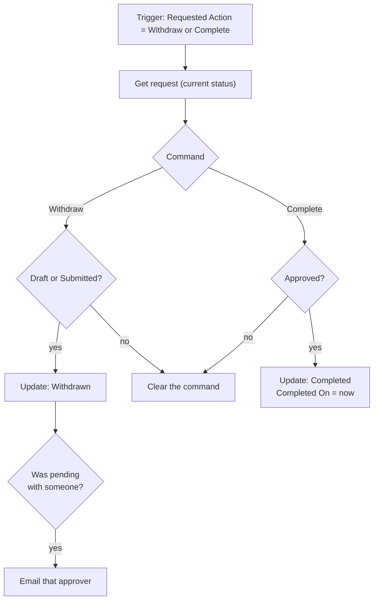

# Flow: Training Request Commands

**TrainingRequests → New → Automation → Cloud flow → Automated**, name
`Training Request Commands`.

Handles the two commands a requester can issue besides Submit: **Withdraw** and **Complete**.
Requesters can't write Request Status themselves (column security), so the canvas app writes the
command into Requested Action and this flow applies it if the current status allows it. Submit is
handled by [`approval-flow.md`](approval-flow.md).

`<WITHDRAW>`, `<DRAFT>` and the like stand for the choice values recorded in
[`../dataverse/schema.md`](../dataverse/schema.md#choice-values--write-them-down).

## Trigger: Dataverse *When a row is added, modified or deleted*

| Setting | Value |
|---|---|
| Change type | **Added or Modified** |
| Table name | Training Requests |
| Scope | **Organization** |
| Select columns | `jc_requestedaction` |
| Filter rows | `jc_requestedaction eq <WITHDRAW> or jc_requestedaction eq <COMPLETE>` |

Every branch below ends by clearing Requested Action, and a blank command doesn't match the filter,
so the flow can't re-trigger itself.

## Actions

**1. `Get request`**: Dataverse *Get a row by ID*
- Table: Training Requests · Row ID: `triggerOutputs()?['body/jc_trainingrequestid']`
- Select columns: `jc_title,jc_requeststatus,jc_requestedaction,jc_pendingwith`

Read the row again instead of trusting the trigger payload. The approval flow may have recorded a
decision in the moment between the requester pressing the button and this run starting.

**2. `Which command`**: *Switch* on `outputs('Get_request')?['body/jc_requestedaction']`

### Case `<WITHDRAW>`

**`Can withdraw?`**: *Condition*
- `outputs('Get_request')?['body/jc_requeststatus']` **is equal to** `<DRAFT>`
- **OR** `outputs('Get_request')?['body/jc_requeststatus']` **is equal to** `<SUBMITTED>`

  **If yes:**
  - **`Update withdrawn`**: Dataverse *Update a row*, same Row ID
    - Request Status: **Withdrawn**
    - Decision Comments: `Withdrawn by the requester.`
    - Requested Action, Pending With, Approval Link: `null`
  - **`Was pending?`**: *Condition*: `empty(outputs('Get_request')?['body/jc_pendingwith'])` **is
    equal to** `false`
    - **If yes → `Email approver`**: Office 365 Outlook *Send an email (V2)*
      - To: `outputs('Get_request')?['body/jc_pendingwith']`
      - Subject: `Withdrawn: training request "@{outputs('Get_request')?['body/jc_title']}"`
      - Body: *The requester withdrew this request. The approval still in your list no longer has
        any effect and can be ignored.*

  **If no → `Ignore withdraw`**: *Update a row*, Requested Action = `null`

The Approvals connector has no action to cancel an approval, so the one already sent stays in the
approver's list until they answer it or it times out. Either way the approval flow re-reads the row,
sees it is no longer Submitted, and writes nothing. The email is there so the approver isn't left
wondering.

### Case `<COMPLETE>`

**`Can complete?`**: *Condition*:
`outputs('Get_request')?['body/jc_requeststatus']` **is equal to** `<APPROVED>`

  **If yes → `Update completed`**: *Update a row*
  - Request Status: **Completed**
  - Completed On: `utcNow()`
  - Requested Action: `null`

  **If no → `Ignore complete`**: *Update a row*, Requested Action = `null`

### Default

**`Ignore unknown`**: *Update a row*, Requested Action = `null`

## If this flow fails or is turned off

The command stays on the row and the app shows *Withdrawing…* or *Updating…* instead of a status.
Those rows appear in the model-driven app's **Needs Attention** view after an hour. Fix the flow,
then clear and re-set Requested Action on the row (as an admin) to run the command again.

## Testing checklist

| # | Test | Expected |
|---|---|---|
| 1 | Withdraw a Draft | Withdrawn, no email |
| 2 | Withdraw a Submitted request | Withdrawn, Pending With and Approval Link cleared, approver emailed. Answering the old approval changes nothing (approval-flow test 6) |
| 3 | Mark an Approved request completed | Completed, Completed On set |
| 4 | As the requester, set `jc_requestedaction` = Complete on a **Submitted** request through the Web API | Command cleared, status unchanged |
| 5 | Same with Withdraw on an **Approved** request | Command cleared, status unchanged |
