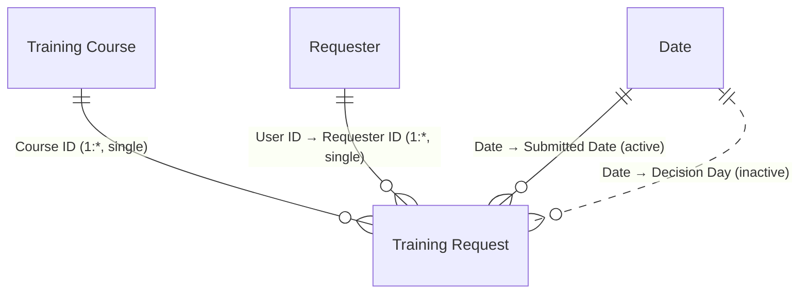

# Power BI: Training Requests dashboard

> **Mac users:** Power BI Desktop is Windows-only. Use Parallels or UTM with Windows 11 ARM, or an
> Azure/Windows 365 Cloud PC. The web service can edit semantic models, but it can't connect
> directly to Dataverse and create a model from scratch, so Desktop is the path of least
> resistance. Save the result as `powerbi/TrainingRequests.pbix` and commit it.

Files in this folder:

| File | Contents |
|---|---|
| `queries.pq` | Power Query for the fact, the two dimensions, and the time-zone parameter |
| `date-table.dax` | The Date table |
| `measures.dax` | All measures |
| `rls.dax` | The hierarchy column and role filters for row-level security |

## 1. Connect

**Get data → Dataverse**, then sign in with your developer account. Expand your environment and check
`jc_trainingrequest`, `jc_trainingcourse`, and `systemuser`. Click **Transform data** (not Load) and
replace each query with the versions in `queries.pq`. Name the queries **Training Request**,
**Training Course**, and **Requester**. Create the **ReportingUtcOffsetHours** parameter first; the
fact query uses it.

- Storage mode: **Import**. This is fast and fine at this size. DirectQuery would push every visual
  to the Dataverse TDS endpoint.
- The Dataverse connector reads through the TDS (SQL) endpoint. If you see "TDS endpoint is disabled",
  turn it on in **Admin center → Environment → Settings → Product → Features → TDS endpoint**.
- **Time zone.** Dataverse stores and returns date-times in UTC. The fact query shifts them by
  `ReportingUtcOffsetHours` (default `-5`) so that a request lands on the calendar day the
  requester experienced. Set it to your reporting time zone's offset.

## 2. Model (star schema)

1. Create the **Date** table from `date-table.dax`, then **Mark as date table**.
2. **Model view** relationships:
   - `'Training Course'[Course ID]` 1 → * `'Training Request'[Course ID]`, single direction
   - `'Requester'[User ID]` 1 → * `'Training Request'[Requester ID]`, single direction
   - `'Date'[Date]` 1 → * `'Training Request'[Submitted Date]`, **active**
   - `'Date'[Date]` 1 → * `'Training Request'[Decision Day]`, **inactive** (used via `USERELATIONSHIP`)
3. Hide the ID and key columns from report view: Course ID (both tables), Request ID, Requester ID,
   User ID, Manager ID, UPN, Submitted Date, and Decision Day.
4. Add the measures from `measures.dax`. Format **Approval Rate** and **Completion Rate** as
   percentage (0 decimals), the spend measures as currency, and **Avg Days to Decision** with 1
   decimal.

The **Requester** is the request's owner, the same definition the security roles, the canvas app,
and the flows use.

Why a star? Filters flow one way, from dimensions to the fact, which keeps DAX predictable. The engine
is optimized for this shape, and a single-direction relationship avoids ambiguous filter paths.

## 3. Report page: *Overview*

| Visual | Fields |
|---|---|
| Card | Total Requests |
| Card | Approval Rate |
| Card | Approved Spend |
| Card | Avg Days to Decision |
| Card | Expired Requests |
| Clustered column | X: `Date[Month]` · Y: Total Requests · Legend: Request Status |
| Donut or bar | Category → Approved Spend |
| Table: *Pending requests* | Title, `Requester[Requester]`, Course, Course Cost, Submitted On, Pending With. Visual filter: Request Status = Submitted. Sort by Submitted On ascending |
| Slicers | `Date[Month]`, `'Training Course'[Category]` |

Optional second page, *Decisions*: a line chart of **Decisions by Decision Date** by month,
next to Total Requests by month. It shows the inactive relationship at work.

## 4. Performance Analyzer

**Optimize → Performance analyzer → Start recording → Refresh visuals.** Expand each visual and
record DAX query, visual display, and total time. Put the table below in the README:

| Visual | DAX query (ms) | Visual display (ms) | Total (ms) |
|---|---|---|---|
| Approval Rate card | | | |
| Requests by month | | | |
| Spend by category | | | |
| Pending table | | | |

What keeps these numbers low: column pruning in Power Query, Import mode, the star schema, measures
instead of calculated columns (the one exception is the security path in `rls.dax`, which has to be a
column), and `SUM` over a fact column instead of `SUMX(RELATED())`. If any visual is noticeably
slower, click **Copy query** and paste it into DAX Studio to see the storage-engine queries.

## 5. Row-level security

**The Dataverse security roles do not protect this report.** Import mode copies the data into the
model using the access of whoever's credentials run the refresh. Everyone who can open the report
then sees that copy, whatever their Dataverse role. An employee who can only see their own requests
in the app would see everyone's here.

So the model carries its own rules, in `rls.dax`:

1. Add the **Hierarchy Path** calculated column to the Requester table.
2. **Modeling → Manage roles**, create the two roles:

   | Role | Sees | For |
   |---|---|---|
   | **Own and team requests** | Their own requests and those of everyone who reports to them, at any depth | Employees and managers. One role covers both: an employee with no reports simply sees their own |
   | **All requests** | Everything | Training Admins |

3. Test before publishing: **Modeling → View as → Own and team requests**, tick *Other user*, and
   enter a test user's sign-in name. The cards and the pending table should shrink to that person's
   reporting line.
4. After publishing, assign people in the service: **workspace → semantic model → ⋯ → Security**.
   Add a security group to each role rather than individuals.

Things to know:

- The manager hierarchy is the **Manager** field on the Dataverse user record, the same field the
  approval flow uses to pick the approver. Report visibility and approval routing therefore agree.
- **Workspace Admins, Members, and Contributors bypass row-level security.** It applies to Viewers
  and to people the report is shared with. Give report consumers Viewer access or share through an
  app.
- The account whose credentials refresh the model must be able to read every request (the Training
  Admin role and the *Read Decision Fields* column profile). The roles above then narrow what each
  viewer sees.
- Data is as fresh as the last refresh, not live.

## 6. Publish (optional)

**Publish → My workspace** for a solo build, or a shared workspace if others will view it. To schedule
a refresh, the service needs Dataverse credentials (OAuth2) under **Semantic model → Settings → Data
source credentials**.
