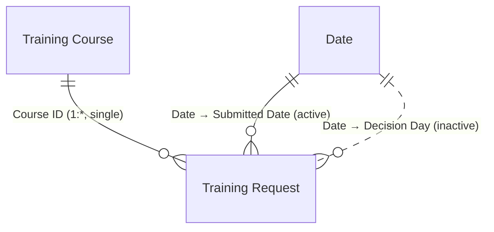

# Power BI: Training Requests dashboard

> **Mac users:** Power BI Desktop is Windows-only. Use Parallels or UTM with Windows 11 ARM, or an
> Azure/Windows 365 Cloud PC. The web service can edit semantic models, but it can't connect
> directly to Dataverse and create a model from scratch, so Desktop is the path of least
> resistance. Save the result as `powerbi/TrainingRequests.pbix` and commit it.

## 1. Connect

**Get data → Dataverse**, then sign in with your developer account. Expand your environment and check
`jc_trainingrequest` and `jc_trainingcourse`. Click **Transform data** (not Load) and replace each
query with the versions in `queries.pq`. Name the queries **Training Request** and **Training Course**.

- Storage mode: **Import**. This is fast and fine at this size. DirectQuery would push every visual
  to the Dataverse TDS endpoint.
- The Dataverse connector reads through the TDS (SQL) endpoint. If you see "TDS endpoint is disabled",
  turn it on in **Admin center → Environment → Settings → Product → Features → TDS endpoint**.

## 2. Model (star schema)

1. Create the **Date** table from `date-table.dax`, then **Mark as date table**.
2. **Model view** relationships:
   - `'Training Course'[Course ID]` 1 → * `'Training Request'[Course ID]`, single direction
   - `'Date'[Date]` 1 → * `'Training Request'[Submitted Date]`, **active**
   - `'Date'[Date]` 1 → * `'Training Request'[Decision Day]`, **inactive** (used via `USERELATIONSHIP`)
3. Hide the ID and key columns from report view: Course ID (both tables), Request ID,
   Submitted Date, and Decision Day.
4. Add the measures from `measures.dax`. Format **Approval Rate** as percentage (0 decimals),
   the spend measures as currency, and **Avg Days to Decision** with 1 decimal.

Why a star? Filters flow one way, from dimensions to the fact, which keeps DAX predictable. The engine
is optimized for this shape, and a single-direction relationship avoids ambiguous filter paths.

## 3. Report page: *Overview*

| Visual | Fields |
|---|---|
| Card | Total Requests |
| Card | Approval Rate |
| Card | Approved Spend |
| Card | Avg Days to Decision |
| Clustered column | X: `Date[Month]` · Y: Total Requests · Legend: Request Status |
| Donut or bar | Category → Approved Spend |
| Table: *Pending requests* | Title, Requester, Course, Course Cost, Submitted On. Visual filter: Request Status = Submitted. Sort by Submitted On ascending |
| Slicers | `Date[Month]`, `'Training Course'[Category]` |

Optional second page, *Decisions*: a line chart of **Decisions by Decision Date** by month,
next to Total Requests by month. It shows the inactive relationship at work.

## 4. Performance Analyzer

**Optimize → Performance analyzer → Start recording → Refresh visuals.** Expand each visual and
record DAX query, visual display, and total time. Put the table below in the README:

| Visual | DAX query (ms) | Visual display (ms) | Total (ms) |
|---|---|---|---|
| Approval Rate card | | | |
| Requests by month | | | |
| Spend by category | | | |
| Pending table | | | |

Talking points: column pruning in Power Query, Import mode, star schema, measures instead of
calculated columns, and `SUM` over a fact column instead of `SUMX(RELATED())`. If any visual is
noticeably slower, click **Copy query** and paste it into DAX Studio to see the storage-engine
queries.

## 5. Publish (optional)

**Publish → My workspace.** To schedule a refresh, the service needs Dataverse credentials
(OAuth2, your dev account) under **Semantic model → Settings → Data source credentials**.
